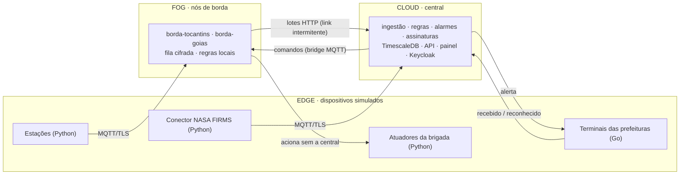

# SENTINELA — Plataforma IoT de detecção e alerta de incêndios

> Projeto da disciplina Internet das Coisas — UniEVANGÉLICA, 2026.
> 2ª entrega: *Documento de Requisitos — Plataforma IoT Integrada v2.0*
> (`Documento de Requisitos - Plataforma IoT Integrada.pdf`, na raiz).

## Resumo

O Sentinela é uma plataforma IoT que integra dois cenários em torno do mesmo
problema, os incêndios no Cerrado:

- **Rural:** estações de detecção em fazendas e áreas de preservação de Goiás e
  Tocantins, atrás de **nós de borda** que decidem sozinhos e guardam tudo
  quando a internet cai.
- **Urbano:** **terminais de alerta** nas prefeituras, Defesa Civil e bombeiros,
  que recebem os incêndios próximos da cidade e devolvem o reconhecimento do
  operador.

A arquitetura é **edge → fog → cloud**. Todas as mensagens seguem um
**contrato canônico** versionado (JSON Schema + AsyncAPI) e trafegam por
**MQTT sobre TLS** com credencial e ACL por dispositivo. A instância central
(FastAPI + PostgreSQL/TimescaleDB) faz a ingestão, executa as regras, controla
os alarmes, oferece a API e o painel web e cuida da identidade (Keycloak).

Não há hardware: todos os dispositivos são simulados em contêineres. Eles usam
dados reais de clima (Open-Meteo) e de focos de calor por satélite (NASA FIRMS),
e há um modo de incêndio forçado para a demonstração.



## Como rodar

Pré-requisito: Docker com Compose v2.

```bash
cp .env.example .env            # segredos de desenvolvimento (opcional: FIRMS_MAP_KEY)
docker compose up -d --build
```

| Endereço | O quê |
|---|---|
| http://localhost:3000 | painel web (login pelo Keycloak) |
| http://localhost:8000/docs | API REST (Swagger, OpenAPI 3) |
| http://localhost:8000/contratos/asyncapi.yaml | contrato MQTT |
| http://localhost:8080 | Keycloak (realm `sentinela`) |
| http://localhost:9090 | Prometheus (métricas e alertas operacionais) |
| `localhost:8883` / `8884` / `8885` | MQTT/TLS: central, borda Tocantins e borda Goiás |

Usuários de demonstração, senha `sentinela` (**só desenvolvimento**):
`gestor.brigada`, `operador.brigada`, `integrador.brigada`, `leitor.brigada`,
`gestor.anapolis` (e as outras prefeituras), `operador.anapolis` e `admin`
(este exige configurar o TOTP).

Para ver tudo funcionando: [roteiro de demonstração](docs/demonstracao.md). Um
incêndio de teste em um comando:

```bash
pip install -r plataforma/requirements.txt
python plataforma/simuladores/demo/cadastrar_alerta_publico.py   # cria o cenário urbano pela API
python plataforma/simuladores/mock_incendio.py on pirenopolis    # e "off" para encerrar
```

## Documentação

| Documento | Conteúdo |
|---|---|
| [Arquitetura](docs/arquitetura.md) | camadas, edge/fog/cloud, implantação, hexagonal, pipeline de ingestão, mensagem canônica |
| [Fluxos](docs/fluxos.md) | sequências: incêndio → prefeitura, zona sem borda, desconexão, regras na borda, comandos |
| [Modelo de dados](docs/dados.md) | MER, hypertables, decisões do banco, fila da borda |
| [MQTT, acesso e segurança](docs/mqtt-e-seguranca.md) | árvore de tópicos, ACL, credenciais, TLS, Keycloak e papéis, LGPD |
| [Decisões de arquitetura (ADRs)](docs/adr/) | 11 decisões com contexto, alternativas e consequências |
| [Kit do integrador](docs/integrador/) | guia, coleção de requisições e exemplos em Python, TypeScript e Go |
| [Matriz de rastreabilidade](docs/rastreabilidade.md) | cada requisito do PDF → onde foi atendido → evidência |
| [Roteiro de demonstração](docs/demonstracao.md) | passo a passo dos critérios de aceite (§9.3) |
| [Operação](docs/operacao.md) | serviços, variáveis, simulação, testes, métricas, carga, problemas conhecidos |
| [Histórico dos contratos](plataforma/contratos/CHANGELOG.md) | versões da mensagem canônica, AsyncAPI e API |
| [Diagramas em PNG](docs/diagramas/) | os 14 diagramas exportados para slides e relatório |

## Situação da entrega

- **Essenciais:** 32 de 33 atendidos. A exceção é a ingestão HTTP local no nó de
  borda (RF-EDG-01), que só aceita MQTT: o desenho prevê o HTTP, mas ele não foi
  implementado.
- **Critérios de aceite da §9.3:**
  - urbano e rural integrados, com borda;
  - desconexão de 72 h sem perda nem duplicata;
  - domínio novo só por configuração;
  - três linguagens (Python, Go e TypeScript).
- **Teste de carga:** nenhuma mensagem perdida a 1.000 msg/s oferecidas, mas a
  vazão sustentada é de ~750 msg/s numa máquina. As latências do RNF-02 só são
  atendidas abaixo de ~700 msg/s.

O detalhamento, incluindo o que ficou fora e por quê, está na
[matriz de rastreabilidade](docs/rastreabilidade.md).

## Tecnologias

| Camada | Tecnologia |
|---|---|
| Dispositivos (simulados) | Python (`paho-mqtt`), Go (`paho.mqtt.golang`) |
| Borda | Python, Mosquitto 2.0 com bridge, SQLite (WAL) + Fernet |
| Ingestão e barramento | Eclipse Mosquitto 2.0 (TLS 1.2+, ACL por dispositivo) |
| Central | Python 3.12, FastAPI, SQLAlchemy Core, Alembic, jsonschema |
| Dados | PostgreSQL 16 + TimescaleDB (hypertables, agregado contínuo) |
| Identidade | Keycloak 26 (OIDC, PKCE, papéis, TOTP) |
| Painel | React 19, TanStack Start/Router, react-query, Leaflet, keycloak-js |
| Observabilidade | logs JSON com correlação, Prometheus |
| Contratos | JSON Schema 2020-12, AsyncAPI 3, OpenAPI 3 |
| Implantação e CI | Docker Compose, GitHub Actions (ruff, pytest, build, Go, front) |

## Estrutura do repositório

```
projeto-iot/
├── docker-compose.yml        # topologia completa (20 serviços, 3 redes)
├── .env.example              # segredos de desenvolvimento (copie para .env)
├── docs/                     # documentação da 2ª entrega (este índice acima)
├── front/                    # painel web (React + TanStack Start)
└── plataforma/
    ├── contratos/            # mensagem canônica (JSON Schema), AsyncAPI, exemplos, CHANGELOG
    ├── nucleo/               # domínio compartilhado central + borda (hexagonal)
    ├── central/              # instância central: API, ingestão, motor, ações, migrations, seed
    ├── borda/                # nó de borda (fog): fila cifrada, regras locais, sincronização
    ├── simuladores/          # estações, atuadores, conector FIRMS, terminal Go, carga, demo
    ├── infra/                # PKI, Mosquitto, Keycloak, Prometheus
    └── tests/                # pytest: núcleo, borda, contrato, integração da central
```

## Zonas monitoradas

| Zona | UF | Nó de borda | Critério de escolha |
|---|---|---|---|
| Anápolis, Formosa, Pirenópolis, Jaraguá | GO | `borda-goias` | zonas solicitadas no trabalho |
| Sandolândia | TO | `borda-tocantins` | zona solicitada no trabalho |
| Mateiros, Lagoa da Confusão | TO | `borda-tocantins` | destaques nacionais de área queimada em 2025 (MapBiomas Fogo) |
| Mirador | MA | — (conexão direta) | destaque nacional de área queimada em 2025 |
| Novo Progresso | PA | — (conexão direta) | ponto representativo da Amazônia paraense |

As prefeituras de Anápolis, Formosa, Pirenópolis e Jaraguá são os inquilinos
urbanos, cada uma com Defesa Civil e bombeiros.

## Referências

- Documento de Requisitos — Plataforma IoT Integrada, v2.0. UniEVANGÉLICA, 2026.
- OASIS. *MQTT Version 3.1.1* (2014) e *MQTT Version 5.0* (2019).
- NASA FIRMS — Fire Information for Resource Management System. https://firms.modaps.eosdis.nasa.gov/
- Schroeder, W. et al. The New VIIRS 375 m active fire detection data product. *Remote Sensing of Environment*, 2014.
- Open-Meteo Weather API. https://open-meteo.com/
- INPE — Programa Queimadas. https://queimadas.dgi.inpe.br/
- MapBiomas Fogo — Mapeamento anual de área queimada. https://brasil.mapbiomas.org/
- Hohpe, G.; Woolf, B. *Enterprise Integration Patterns*. Addison-Wesley, 2003.
- Cockburn, A. *Hexagonal Architecture (Ports and Adapters)*, 2005.
- Timescale. TimescaleDB documentation. https://docs.timescale.com/
- Keycloak documentation. https://www.keycloak.org/documentation
- Eclipse Mosquitto. https://mosquitto.org/
- Brasil. Lei nº 13.709/2018 (LGPD).
