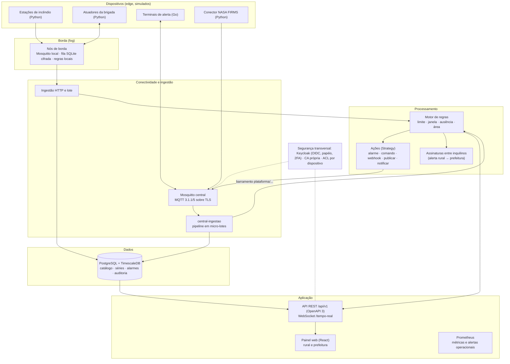
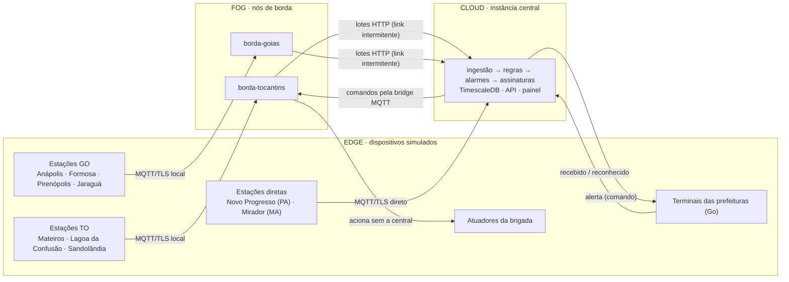
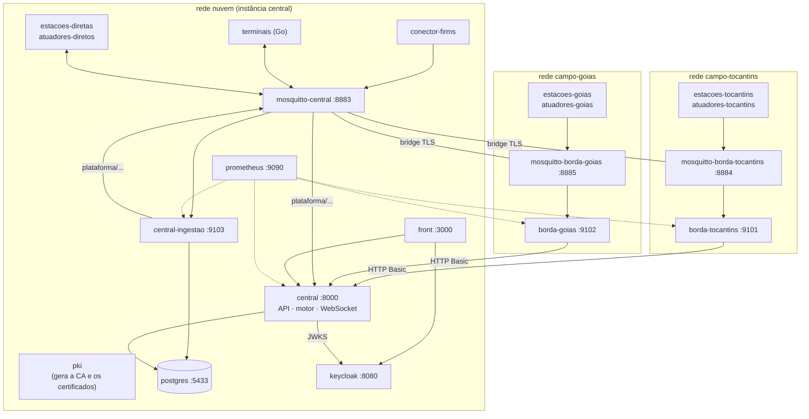
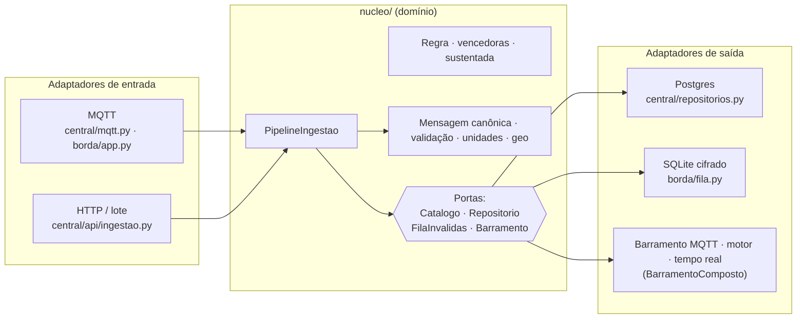
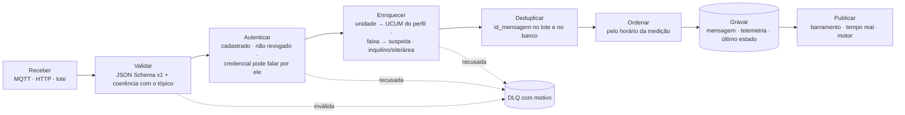

# Arquitetura

O Sentinela é uma plataforma IoT para **detecção de incêndio no Cerrado** que
integra dois cenários:

- **rural**: estações de detecção nas fazendas e áreas de preservação, atrás de
  um **nó de borda** que funciona sem internet;
- **urbano**: **terminais de alerta** nas prefeituras, Defesa Civil e bombeiros,
  que recebem os alertas de incêndio próximos da cidade e devolvem o
  reconhecimento do operador.

Não há hardware: todos os dispositivos são simuladores em contêiner (o PDF de
requisitos põe hardware fora do escopo, §1.2). Tudo sobe com um
`docker compose up`.

## 1. Visão em camadas

Adaptação da Figura 3.1 do documento de requisitos.



| Camada | Componentes | Requisitos principais |
|---|---|---|
| Dispositivos | `estacoes-*`, `atuadores-*`, `terminais` (Go), `conector-firms` | RF-INT-02, RF-INT-04, RF-DIS-05 |
| Borda | `borda-*` + `mosquitto-borda-*` | RF-EDG-01..06, RF-SEG-05 |
| Ingestão | `mosquitto-central`, `central-ingestao`, `POST /ingestao` e `/ingestao/lote` | RF-ING-01..04, 06, 08 |
| Dados | `postgres` (TimescaleDB) | RF-DAD-01, 02, 06; RF-PRO-04 |
| Processamento | motor de regras, ações, assinaturas (dentro de `central`) | RF-PRO-01..05 |
| Aplicação | API, WebSocket, painel `front`, Prometheus | RF-APP-01..07, RF-OBS-01..05 |
| Segurança | `keycloak`, `pki`, ACL do Mosquitto | RF-SEG-01..05, RNF-11 |

## 2. Edge → Fog → Cloud

Cada nível tem processamento próprio; o que roda onde:



| Nível | Onde roda | O que processa |
|---|---|---|
| **Edge** | estações, atuadores, terminais e conector (contêineres) | Leitura com ruído sobre dados reais (Open-Meteo e NASA FIRMS); `id_mensagem` e horário gerados na origem; **pré-filtro**: só envia quando o valor varia além de um limiar ou vence o intervalo do perfil (economiza banda). |
| **Fog** | `borda-tocantins`, `borda-goias` (referência: Raspberry Pi 5) | Validação contra o contrato; **fila SQLite (WAL) cifrada com Fernet**; **regras locais**: risco crítico aciona a brigada sem a central; prioridade alarme > estado > telemetria na sincronização; regras e ACL baixadas da central e guardadas no disco; métricas próprias. |
| **Cloud** | `central`, `central-ingestao`, `postgres` | Deduplicação e ordenação pelo horário da medição, enriquecimento pelo cadastro, histórico, regras com janela/ausência/área, ciclo de vida dos alarmes, correlação com satélite, **assinaturas que levam o alerta às prefeituras**, API, painel e segurança. |

Decisões (detalhes nos [ADRs](adr/)):

- **Dois nós de borda**, um por região rural, como na Figura 3.2 do PDF.
  Pará e Maranhão não têm borda: suas estações falam direto com a central, como
  um local de boa conexão. Nesses casos quem decide é a central.
- **O cenário urbano não usa borda**: as prefeituras têm link contínuo.
- **Mesmo código de domínio na fog e na cloud** (pacote `nucleo/`), com
  adaptadores diferentes: SQLite na borda e Postgres na central.
- **Subida borda → central por lotes HTTP** (`POST /api/v1/ingestao/lote`), com
  resultado por mensagem: só sai da fila o que a central confirmou. O fluxo
  normal e a sincronização depois de uma queda são o mesmo caminho.
- **Descida central → campo pela bridge do Mosquitto** (`cleansession false`):
  comandos emitidos com o link fora ficam guardados e chegam na volta.

## 3. Implantação

Os serviços do `docker-compose.yml`, por rede. As redes `campo-*` simulam a rede
local de cada fazenda; desconectar a borda da rede `nuvem` simula a queda do link
(`plataforma/simuladores/demo/link.sh`).



Portas publicadas na máquina: 3000 (painel), 8000 (API e Swagger em `/docs`),
8080 (Keycloak), 8883/8884/8885 (MQTT/TLS central, borda TO, borda GO),
9090 (Prometheus), 9101/9102 (métricas das bordas), 9103 (métricas da
ingestão) e 5433 (Postgres).

## 4. Arquitetura hexagonal de cada serviço

O domínio (`plataforma/nucleo/`) não conhece protocolo, banco nem cenário. A
central e a borda montam o mesmo caso de uso com adaptadores diferentes
(Figura 7.1 do PDF).



Padrões usados:

| Padrão | Onde |
|---|---|
| Pipes and Filters | `nucleo/ingestao.py`: validar → autenticar → enriquecer → deduplicar → ordenar → gravar → publicar |
| Idempotent Receiver | `mensagem.id_mensagem` é chave primária; `INSERT … ON CONFLICT DO NOTHING` na mesma transação da telemetria |
| Dead Letter Channel | tabela `dlq` (central) e `invalidas` (borda), sempre com o motivo |
| Observer | `BarramentoComposto`: cada mensagem aceita vai ao MQTT, ao tempo real e ao motor |
| Strategy | `central/acoes.py`: um tipo de ação = uma classe |
| Retry com backoff | `ExecutorAcoes`: 2 s, 4 s, 8 s… até 5 min, no máximo 6 tentativas |
| Repository | `central/repositorios.py` |
| Store-and-forward | `borda/fila.py` + `borda/sincronizador.py` |
| Type Object | domínios e perfis são dados (`dominio`, `perfil_dispositivo`), não classes |

## 5. Pipeline de ingestão

Figura 5.1 do PDF, como está implementada (`nucleo/ingestao.py`). O mesmo
pipeline atende MQTT (micro-lotes), HTTP (uma mensagem) e lotes da borda.



- **Dado atrasado** entra na posição certa da série (hypertable ordenada por
  `tempo`), não sobrescreve o último estado se for mais velho e não abre alarme
  "atual" se tiver mais de 5 minutos (RF-ING-04).
- **Micro-lotes no MQTT**: o callback só enfileira; uma thread grava de uma vez
  tudo o que se acumulou (lote de 1 com pouca carga, sem espera).
- **Ingestão separada**: o serviço `central-ingestao` faz o pipeline MQTT e
  publica as aceitas em `plataforma/{tipo}/…`; a API ouve esse barramento e
  alimenta o motor e o tempo real ([ADR 0009](adr/0009-ingestao-mqtt-separada.md)).

## 6. Mensagem canônica

Todas as mensagens circulam num formato único e versionado
(`plataforma/contratos/mensagem-canonica.v1.schema.json`, AsyncAPI em
`plataforma/contratos/asyncapi.yaml`):

```json
{
  "versao": "1.0",
  "id_mensagem": "8a1f0c2e-6b4d-4f1a-9c3e-2d7b5e9a0f11",
  "dispositivo": "est-mateiros-01",
  "tipo": "telemetria",
  "timestamp": "2026-10-19T14:05:00.000Z",
  "local": { "geo": { "type": "Point", "coordinates": [-46.4168, -10.5464] } },
  "medidas": [
    { "grandeza": "temperatura", "valor": 34.2, "unidade": "Cel" },
    { "grandeza": "umidade", "valor": 18.0, "unidade": "%" },
    { "grandeza": "fumaca", "valor": 62.5, "unidade": "1" }
  ]
}
```

- `tipo`: `telemetria`, `evento`, `estado` ou `comando`.
- `timestamp`: horário **da medição**, em UTC; é ele que ordena a série.
- `unidade`: código UCUM; a ingestão converte para a unidade do perfil.
- `via`: preenchido pelo nó de borda que encaminhou.
- `dados`: conteúdo livre de eventos, estado e comandos.

Tópico MQTT: `{inquilino}/{site}/{dominio}/{dispositivo}/{tipo}`; árvore
completa e ACL em [mqtt-e-seguranca.md](mqtt-e-seguranca.md).
