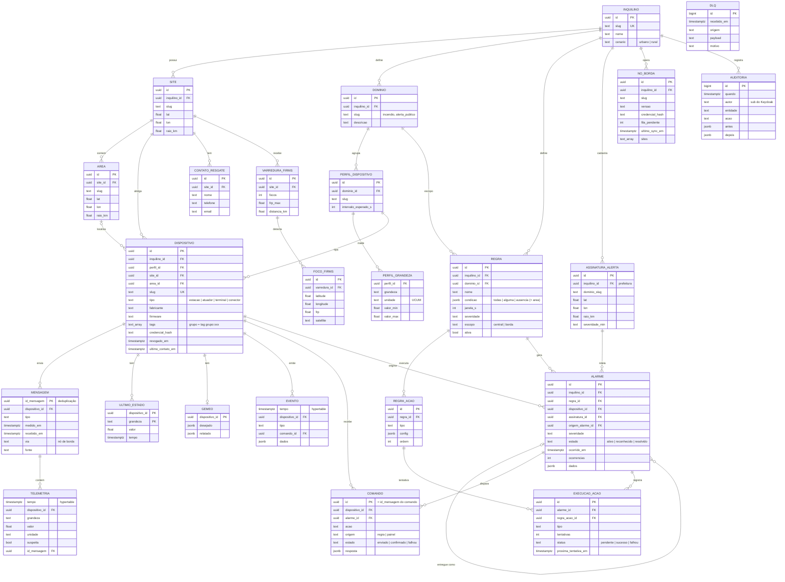

# Modelo de dados

Banco único **PostgreSQL 16 + TimescaleDB**, com partes relacionais (catálogo,
alarmes, auditoria) e séries temporais (hypertables). O esquema é criado pelas
migrations Alembic em `plataforma/central/migrations/versions/`:

| Migration | Conteúdo |
|---|---|
| `0001_mer_inicial` | catálogo, dispositivos, mensagens, séries, gêmeo, comandos, FIRMS, DLQ, auditoria, agregado `telemetria_1h` |
| `0002_regras_alarmes` | regras, ações, alarmes, execuções de ações, assinaturas de alerta |
| `0003_bordas_sites` | sites atendidos por cada nó de borda |
| `0004_tags_dispositivo` | tags e grupos de dispositivos (`text[]` com índice GIN) |

O MER foi derivado dos JSONs que já circulavam na 1ª entrega (leitura do sensor,
resultado FIRMS, alerta do gateway, comando do painel e lista de zonas).

## 1. MER

## 2. Decisões

- **Hypertables**: `telemetria` (partição diária) e `evento` (semanal), ambas
  pela coluna `tempo` = horário da medição. Assim, um dado atrasado entra na
  posição certa do histórico.
- **Compressão** da `telemetria` depois de 7 dias, segmentada por dispositivo e
  grandeza.
- **Agregado contínuo `telemetria_1h`**: média, mínimo, máximo e número de
  amostras por hora (RF-PRO-04), com `materialized_only = false`, o que mantém a
  última hora sempre atualizada. Consultado com `agregacao=1h` em
  `GET /api/v1/telemetria` e `GET /api/v1/dispositivos/{slug}/telemetria`.
- **Deduplicação**: `mensagem.id_mensagem` é a chave primária. A inserção usa
  `ON CONFLICT DO NOTHING` e a telemetria só é gravada para os ids novos, na
  mesma transação. `mensagem` é tabela comum, porque numa hypertable o `tempo`
  teria de fazer parte da chave.
- **Último estado** (RF-DAD-02): `ultimo_estado` só é atualizado quando a
  leitura nova é mais recente que a gravada. Um lote atrasado não sobrescreve um
  valor mais novo.
- **Isolamento por inquilino** (RF-SEG-03): toda tabela de negócio chega a
  `inquilino_id`, direto ou via site/dispositivo, e toda consulta da API filtra
  pelo inquilino do token.
- **Alarmes entregues** a outros inquilinos (assinaturas) são linhas novas com
  `origem_alarme_id` apontando para o alarme rural e `dispositivo_id` vazio. A
  prefeitura não enxerga o dispositivo da brigada.
- **Um alarme aberto por (dispositivo, regra)**: índice único parcial
  `WHERE estado <> 'resolvido'`. Repetições incrementam `ocorrencias`.
- **Geometria**: ponto + raio (Haversine em `nucleo/geo.py`). Polígonos
  (PostGIS) ficam para evolução (RF-CEN-04, ver
  [rastreabilidade](rastreabilidade.md)).
- **Usuários ficam no Keycloak**: o banco guarda só o `sub` em
  `auditoria.autor`, `reconhecido_por` e `resolvido_por`.
- **Credenciais**: só o hash, no formato `$7$` do Mosquitto (PBKDF2-SHA512).

## 3. Borda (SQLite)

Cada nó de borda tem o próprio banco SQLite em modo WAL (escrita transacional:
uma queda de energia não corrompe a fila, RNF-07):

| Tabela | Conteúdo |
|---|---|
| `fila` | `id_mensagem` (PK), prioridade (10 alarme, 1 estado, 0 telemetria), `payload` **cifrado com Fernet**, criado/enviado em |
| `invalidas` | mensagens recusadas na validação local, com o motivo |

Sem a chave (`BORDA_CHAVE_*`), o disco retirado do nó não revela os dados
(RF-SEG-05). Mensagens confirmadas pela central ficam uma hora e depois são
apagadas.
