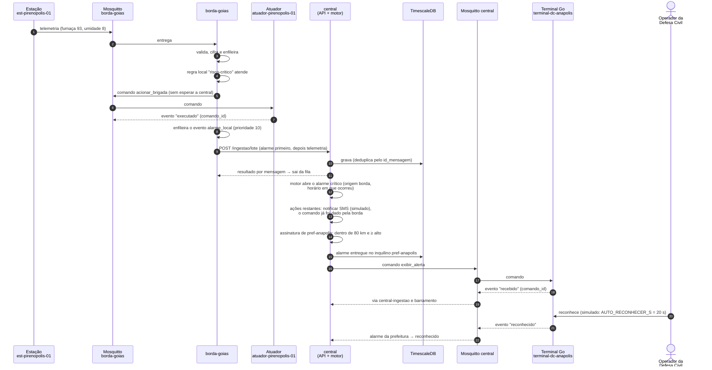
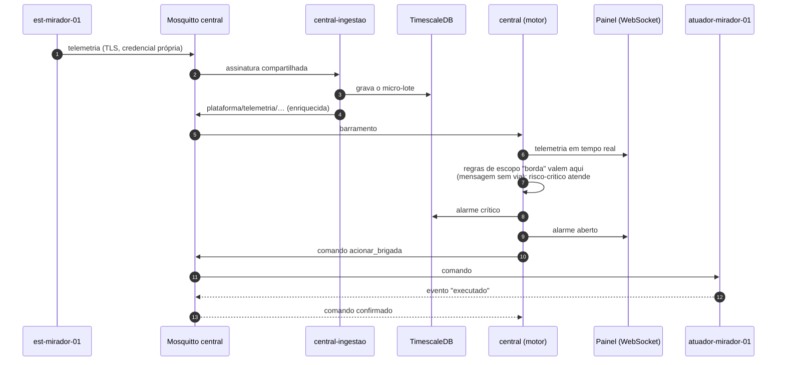
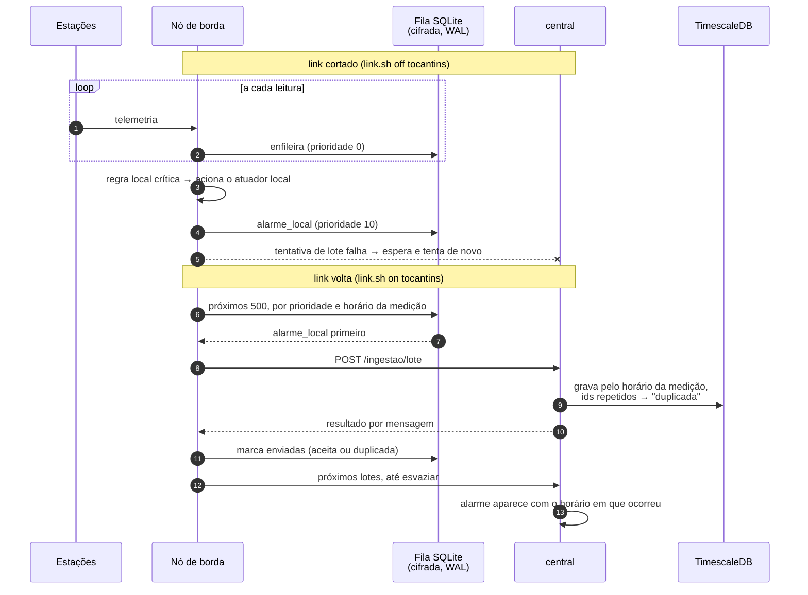
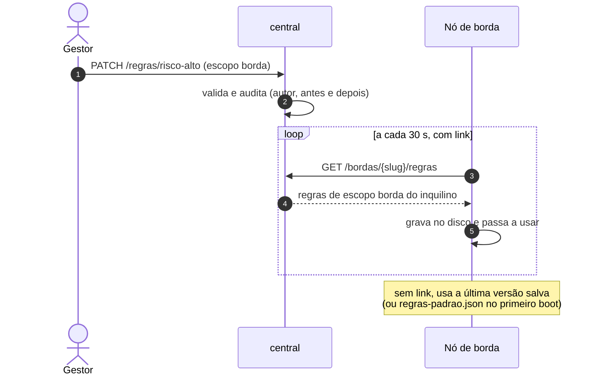
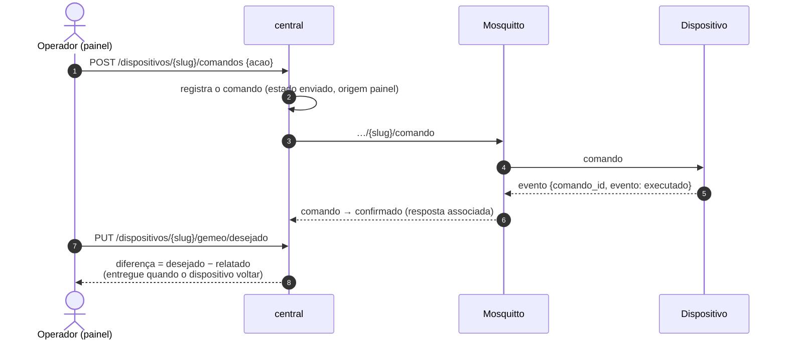

# Fluxos

## 1. Ponta a ponta: incêndio na fazenda → alerta na prefeitura

Incêndio em Pirenópolis (GO), atrás da borda de Goiás. A Prefeitura de Anápolis
assinou "incêndios de severidade alta ou crítica a até 80 km da cidade".

Quando a leitura volta ao normal, a central resolve o alarme da brigada. A
resolução encerra as entregas, e os terminais recebem `encerrar_alerta`.

## 2. Zona sem borda: a central decide

Mirador (MA) e Novo Progresso (PA) não têm nó de borda.

## 3. Desconexão e sincronização (store-and-forward)

Critério da §9.3: o link da borda cai por horas e, na volta, nada se perde nem
se duplica.

- Só sai da fila o que a central confirmou. Se o link cair no meio de um lote, o
  lote inteiro é reenviado, e a central marca as que já tinha como `duplicada`.
- Os comandos da central para o campo, emitidos com o link fora, ficam na sessão
  persistente da bridge e chegam na reconexão.
- O teste automatizado `tests/test_borda.py` injeta 72 h de leituras com o link
  fora e confere a contagem, a ordem e a ausência de duplicatas.

## 4. Regra alterada na central chega à borda

## 5. Comando pelo painel e gêmeo

