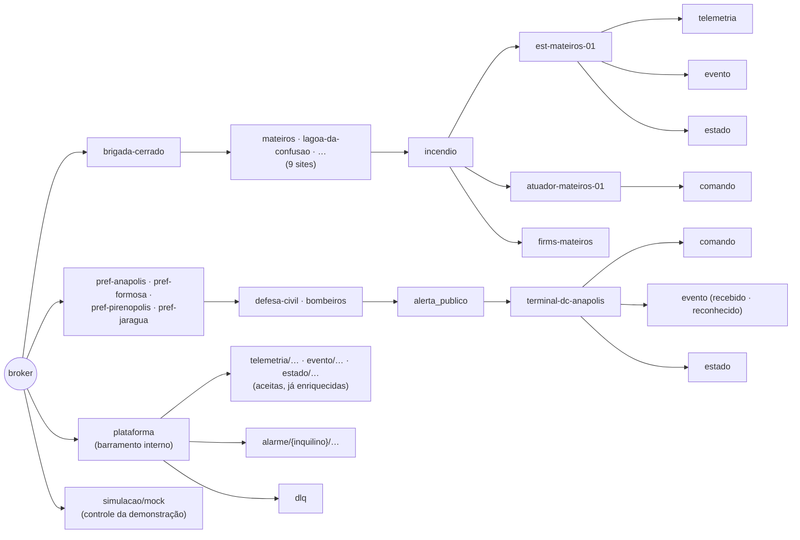
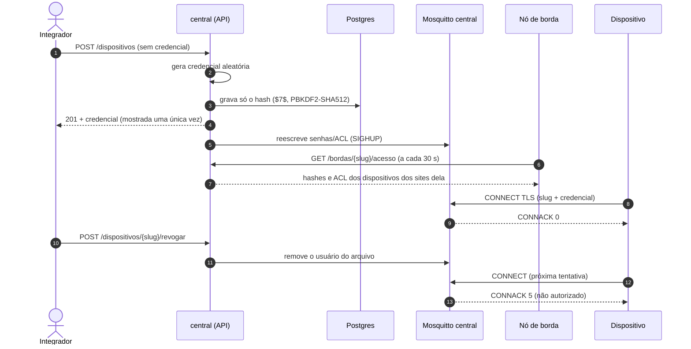

# MQTT, acesso e segurança

## 1. Árvore de tópicos

Padrão canônico: `{inquilino}/{site}/{dominio}/{dispositivo}/{tipo}`, com `tipo`
∈ `telemetria | evento | estado | comando`. O contrato está em
`plataforma/contratos/asyncapi.yaml`.



| Tópico | Quem publica | Quem assina |
|---|---|---|
| `{…}/{dispositivo}/telemetria`, `/evento`, `/estado` | o próprio dispositivo | borda da região ou `central-ingestao` |
| `{…}/{dispositivo}/comando` | central (regras, painel) ou borda (regra local) | o próprio dispositivo |
| `plataforma/{tipo}/{inquilino}/{site}/{dominio}/{dispositivo}` | `central-ingestao` (e a API para o que chega por HTTP) | API (motor de regras e tempo real) |
| `plataforma/alarme/{inquilino}/…` | motor de regras | integrações internas |
| `plataforma/dlq` | ingestão | operação |
| `simulacao/mock` | `mock_incendio.py` (usuário `simulacao`) | estações e conector FIRMS |

## 2. ACL por dispositivo

A central gera o `password_file` e o `acl_file` do Mosquitto a partir do
cadastro (`plataforma/central/acesso_mqtt.py`). Exemplo real para a estação de
Mateiros:

```text
user est-mateiros-01
topic write brigada-cerrado/mateiros/incendio/est-mateiros-01/telemetria
topic write brigada-cerrado/mateiros/incendio/est-mateiros-01/evento
topic write brigada-cerrado/mateiros/incendio/est-mateiros-01/estado
topic read  brigada-cerrado/mateiros/incendio/est-mateiros-01/comando
```

- Publicar no tópico de outro dispositivo é recusado, na central e nas bordas
  (RF-SEG-04). O Mosquitto 2.0 confirma o SUBACK de um tópico proibido, mas não
  entrega nenhuma mensagem dele.
- Cada **nó de borda** baixa a parte dele (`GET /api/v1/bordas/{slug}/acesso`) e
  a guarda no disco: sem link, o broker local continua autenticando os
  dispositivos da fazenda.
- A **bridge** da borda (usuário = slug da borda) só lê, na central, os
  `/comando` dos sites daquela borda.
- O broker relê os arquivos quando eles mudam (`infra/mosquitto/iniciar.sh`
  manda SIGHUP).

## 3. Credenciais e revogação



- **Dispositivos cadastrados pela API**: credencial aleatória, mostrada uma vez.
  `POST /dispositivos/{slug}/credencial` gera uma nova, ou reprovisiona uma
  informada, e a anterior deixa de valer.
- **Dispositivos simulados**: como não há fábrica para gravar a credencial no
  aparelho, ela é derivada de `SEGREDO_PROVISIONAMENTO` por HMAC
  (`nucleo/credenciais.py`, a mesma função em Go no terminal, com vetor de teste
  cruzado).
- **Nós de borda**: credencial própria (`CREDENCIAL_BORDA_*`), usada no HTTP
  Basic com a API e na bridge MQTT.
- Só hashes circulam entre central e bordas; nenhuma senha em claro.

## 4. TLS

- Todo MQTT é **TLS 1.2+** (portas 8883 central, 8884 borda TO, 8885 borda GO),
  sem acesso anônimo (RNF-11, RF-ING-01).
- O serviço `pki` gera uma **CA própria** e os certificados dos brokers
  (`plataforma/infra/pki/gerar.py`, idempotente; saída em
  `plataforma/infra/pki/gerado/`, fora do git). Clientes verificam o broker
  pela CA (`MQTT_CA`).
- A API HTTP e o Keycloak rodam em HTTP **só no ambiente local**. Em produção
  ficariam atrás de um proxy reverso com TLS (Traefik, ver
  [rastreabilidade](rastreabilidade.md)).

## 5. Pessoas: Keycloak e papéis

Realm `sentinela` versionado em `plataforma/infra/keycloak/sentinela-realm.json`:

- **OpenID Connect**: o painel usa o cliente `painel` (Authorization Code +
  PKCE); scripts de desenvolvimento usam o cliente `cli` (password grant).
- O **inquilino** vai no token (claim `inquilino`), com audiência `sentinela-api`.
  A API valida a assinatura RS256 pelo JWKS do Keycloak.
- O papel **admin** tem TOTP obrigatório (`CONFIGURE_TOTP`): sem segundo fator,
  não entra (RF-SEG-01). Só o admin pode agir em outro inquilino, pelo
  cabeçalho `X-Inquilino`.

| Ação na API | leitor | operador | integrador | gestor | admin |
|---|:-:|:-:|:-:|:-:|:-:|
| Consultar catálogo, dispositivos, séries, alarmes, painel, eventos, bordas | ✔ | ✔ | ✔ | ✔ | ✔ |
| Reconhecer/resolver alarme, enviar comando, gêmeo desejado | | ✔ | | ✔ | ✔ |
| Cadastrar perfil e dispositivo, credencial, revogar | | | ✔ | ✔ | ✔ |
| Ingerir por HTTP com token de usuário | | | ✔ | ✔ | ✔ |
| Criar site, área, domínio, regra, assinatura; ver auditoria | | | | ✔ | ✔ |
| Inquilinos, DLQ, outro inquilino (`X-Inquilino`) | | | | | ✔ |

Máquinas autenticam por **HTTP Basic** (slug + credencial):

| Máquina | Pode |
|---|---|
| Dispositivo | `POST /ingestao` só com as próprias mensagens |
| Nó de borda | `POST /ingestao/lote` para os dispositivos dos sites dele; `PUT /bordas/{slug}/estado`, `GET /bordas/{slug}/acesso` e `/regras`, só da própria borda |

Usuários de demonstração (senha `sentinela`, **só desenvolvimento**):
`gestor.brigada`, `operador.brigada`, `integrador.brigada`, `leitor.brigada`,
`gestor.anapolis`, `gestor.formosa`, `gestor.pirenopolis`, `gestor.jaragua`,
`operador.anapolis` e `admin` (este exige TOTP no primeiro acesso).

## 6. Dados pessoais (LGPD)

- Destinos de notificação (telefone, e-mail) aparecem **mascarados**
  (`***0001`, `b***@dominio`) para quem não é gestor e nos logs (RF-DAD-05).
- `contato_resgate` não é exposto na API.
- Alarmes entregues às prefeituras não carregam o dispositivo nem os dados
  internos da brigada; só o resumo, a severidade e o local.
- Toda alteração de dispositivo, regra, assinatura ou alarme fica na
  `auditoria`, com autor, data, valor anterior e novo (RF-DAD-06).

## 7. Segredos

Ficam no `.env`, fora do git; o modelo é o `.env.example`, com valores
`dev-…-troque-esta-senha`. Os do `.env.example` servem só para desenvolvimento:
troque todos fora da sua máquina.
